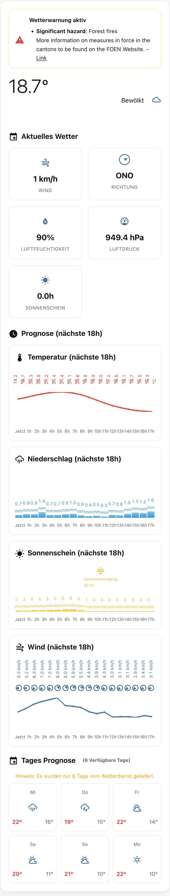
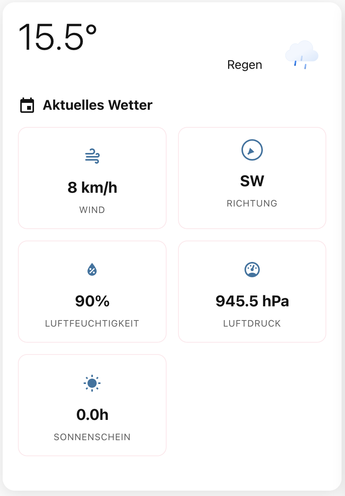
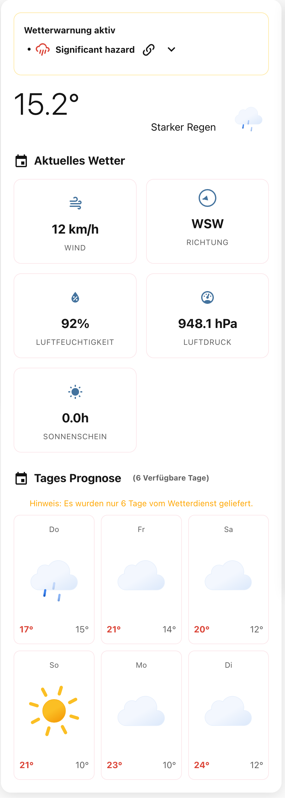
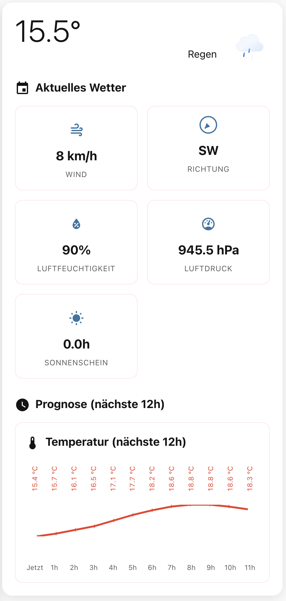
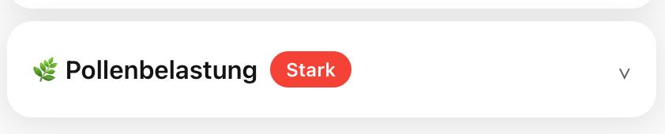
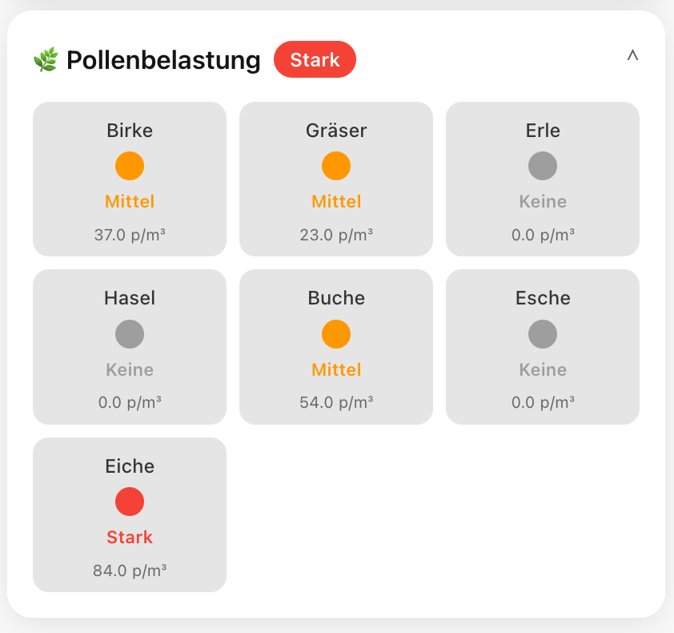

# SwissWeather Home Assistant Card

[](https://github.com/hacs/integration)
[](https://github.com/dmoo500/ha-swissweather-card/releases)
[](LICENSE)
[](https://github.com/dmoo500/ha-swissweather-card/issues)

Swiss weather at a glance: forecasts, warnings, sunshine, wind, and pollen on your Home Assistant dashboard. Inspired by the SwissWeather app, built with TypeScript, Lit, and responsive SVG charts.

Use the **Full Card** for an overview or combine **standalone cards** to build your own layout. An experimental animated-background card is also included.

## Contents

- [Features](#features)
- [Screenshots](#screenshots)
- [Requirements and weather data](#requirements-and-weather-data)
- [Installation](#installation)
- [Quick start](#quick-start)
- [Available cards](#available-cards)
- [Configuration](#configuration)
- [Chart interaction](#chart-interaction)
- [Updating and beta releases](#updating-and-beta-releases)
- [Troubleshooting](#troubleshooting)
- [Development and contributing](#development-and-contributing)
- [Links and acknowledgements](#links-and-acknowledgements)

## Features

| Feature | What you get |
| --- | --- |
| Weather overview | Current conditions, temperature, wind, humidity, pressure, and optional sunshine sensor readings |
| Daily forecast | Up to seven days, weather icons, and minimum/maximum temperatures; compact SVG diagram |
| Hourly charts | Temperature, precipitation amount/probability, sunshine duration, and wind speed/direction |
| Chart interaction | Daily diagram and hourly temperature, precipitation, and wind tooltips for mouse, touch, and keyboard |
| Weather warnings | Color-coded severity levels, hazard icons, and support for legacy or ranked warning sensors |
| Pollen | Seven pollen types, severity badge, collapsible details, and optional particle counts |
| Presentation | Visual editors, configurable chart order, compact mode, and optional animated weather icons |

Available data depends on your weather integration; installing the card does not create weather or sensor entities.

## Screenshots

<table>
  <tr>
    <th>Full overview</th>
    <th>Minimal layout</th>
    <th>Warnings and forecast</th>
  </tr>
  <tr>
    <td></td>
    <td></td>
    <td></td>
  </tr>
  <tr>
    <th>Temperature diagram</th>
    <th>Pollen summary</th>
    <th>Pollen details</th>
  </tr>
  <tr>
    <td></td>
    <td></td>
    <td></td>
  </tr>
</table>

Screenshots illustrate example configurations and may differ from the latest beta.

## Requirements and weather data

- **Home Assistant 2025.8+** is the recommended baseline.
- Use a current browser with ES2022, custom elements, and SVG support.
- Forecast cards need a `weather.*` entity supporting `weather.get_forecasts`. Hourly charts require hourly forecasts; daily views require daily forecasts.
- Sunshine duration, precipitation probability, and wind bearing appear only if the integration supplies them.
- Warning and pollen cards need the corresponding sensor entities.

Recommended integration: [hass-swissweather](https://github.com/izacus/hass-swissweather). Ranked warning sensors from [mastameista/hass-swissweather](https://github.com/mastameista/hass-swissweather) are also supported. Other Home Assistant weather integrations can be used, but may not provide every field.

## Installation

### HACS

[](https://my.home-assistant.io/redirect/hacs_repository/?owner=dmoo500&repository=ha-swissweather-card&category=frontend)

1. Open the repository using the button above, or add `https://github.com/dmoo500/ha-swissweather-card` under **HACS → Custom repositories** as a dashboard/Lovelace repository.
2. Find **SwissWeather Card** and download the desired release.
3. Reload your browser. A Home Assistant restart is normally not needed for a dashboard resource.
4. If the resource was not added automatically, add it under **Settings → Dashboards → Resources**:
   - URL: `/hacsfiles/ha-swissweather-card/swissweather-card.js`
   - Type: **JavaScript module**

Resource management may require advanced mode in your Home Assistant profile.

### Manual installation

1. Download `swissweather-card.js` from [Releases](https://github.com/dmoo500/ha-swissweather-card/releases).
2. Copy it to `/config/www/swissweather-card.js`.
3. Add a dashboard resource:
   - URL: `/local/swissweather-card.js`
   - Type: **JavaScript module**
4. Reload the browser, then add a card.

Use either the HACS resource or the manual resource, not both.

## Quick start

Open **Edit dashboard → Add card** and search for **SwissWeather**. Choose the overview or a standalone card, select your entities, and configure the display in its visual editor.

For a minimal Full Card, use:

```yaml
type: custom:swissweather-card
entity: weather.home
location: Zurich
```

Replace `weather.home` with an existing weather entity.

## Available cards

All variants are included in the same JavaScript resource.

| Card | YAML `type` | Purpose |
| --- | --- | --- |
| Full Card | `custom:swissweather-card` | Current weather, warnings, and configurable forecast sections |
| Daily Forecast Diagram | `custom:swissweather-forecast-diagram-card` | Standalone daily SVG diagram |
| Temperature | `custom:swissweather-temperature-card` | Hourly temperature line |
| Precipitation | `custom:swissweather-precipitation-card` | Hourly amount and probability bars |
| Sunshine | `custom:swissweather-sunshine-card` | Hourly sunshine duration with optional sun markers |
| Wind | `custom:swissweather-wind-card` | Hourly speed and direction arrows |
| Warnings | `custom:swissweather-warning-card` | Weather warning sensors |
| Pollen | `custom:swissweather-pollen-card` | Pollen sensor summary and details |
| Animated Background | `custom:swissweather-animated-background-card` | Experimental weather scenes |

For example, to add only a wind chart:

```yaml
type: custom:swissweather-wind-card
entity: weather.home
forecast_hours: 12
```

Standalone hourly editors allow **6–48 hours**. The Full Card editor allows **6–18 hours**. The actual number of readings depends on the integration.

## Configuration

### Full Card example

```yaml
type: custom:swissweather-card
entity: weather.home
location: Zurich
show_location: true
show_warnings: true
show_temperature: true
show_precipitation: true
show_sunshine: true
show_wind: true
show_forecast: true
forecast_hours: 12
compact_mode: false
enable_animate_weather_icons: true
sun_entity: sun.sun
chart_order:
  - temperature
  - precipitation
  - sunshine
  - wind
  - forecast
```

### Full Card options

| Option | Default | Description |
| --- | --- | --- |
| `entity` | Required | Weather entity for current conditions and forecasts |
| `location` | Translated location label | Displayed place name |
| `show_location` | `true` | Show the location header |
| `show_warnings` | Enabled in editor presets | Show active warnings when warning sensors are configured |
| `show_temperature` | `true` | Show hourly temperature |
| `show_precipitation` | `true` | Show hourly precipitation |
| `show_sunshine` | `true` | Show hourly sunshine |
| `show_wind` | `true` | Show hourly wind |
| `show_forecast` | `true` | Show daily forecasts |
| `forecast_hours` | `6` | Hours requested for the hourly display |
| `compact_mode` | `false` | Compact current metrics and daily diagram instead of daily tiles |
| `enable_animate_weather_icons` | Enabled in editor presets | Use animated rather than static weather icons |
| `chart_order` | Temperature, precipitation, sunshine, wind, forecast | Section order; visibility switches still apply |
| `sun_entity` | `sun.sun` | Sun entity for sunrise/sunset markers |
| `wind_entity` | Weather entity value | Optional current wind-speed sensor |
| `wind_direction_entity` | Weather entity value | Optional current wind-bearing sensor |
| `sunshine_entity` | None | Optional current sunshine-duration sensor |
| `warning_entity` | None | Legacy aggregated weather-warning sensor |
| `primary_warning_entity` | None | Ranked primary warning sensor |
| `secondary_warning_entity` | None | Ranked secondary warning sensor |
| `tertiary_warning_entity` | None | Ranked tertiary warning sensor |

Use your own sensor IDs. Ranked warning sensors take precedence over the legacy aggregated sensor. Hourly charts use forecast fields from the weather entity, not the optional current-value sensors.

See [configuration examples](docs/configuration.md) and the [visual editor guide](docs/visual-editor-guide.md) for additional setup information.

## Chart interaction

- **Mouse:** hover over or click an interval in the daily diagram or hourly temperature, wind, and precipitation charts to show its exact readings.
- **Touch:** tap an interval to display its tooltip.
- **Keyboard:** Tab to an interval; focus, Enter, or Space opens its tooltip. Escape or moving focus away dismisses it.
- Temperature and wind curves have no visible point markers. Invisible hit areas preserve access to the readings.
- Wind compass arrowheads indicate the supplied wind bearing.
- Card text, editors, and daily diagram precipitation labels follow your Home Assistant language (German, English, French, or Italian), including regional variants such as `fr-CH`. Unsupported languages fall back to English.
- Missing precipitation metrics are omitted from tooltips; an explicit zero remains visible as a measured value.

These controls apply to the daily SVG diagram and the hourly temperature, wind, and precipitation charts, both embedded and standalone.
They share one tooltip controller and display readings in a consistent top-left panel inside the chart. Hover-only text remains visible while crossing headings or empty areas to reach the panel, which is hoverable without selecting values underneath it. Leaving the chart, clicking its background, or pressing Escape dismisses hover-only text; a keyboard-focused reading is restored on pointer exit unless explicitly dismissed.

## Updating and beta releases

- **Updating to 2.0.0:** existing card type names are unchanged. Development now requires Node.js 22.18.0+, but using the card in Home Assistant does not require Node.js.
- Update through HACS, or replace the JavaScript file for a manual installation.
- Reload the dashboard; if an older version remains visible, hard-refresh the browser or clear the frontend cache.
- To test a beta, enable pre-release versions in the repository's HACS download/version selection. Beta releases may contain regressions.
- Read [CHANGELOG.md](CHANGELOG.md) and the selected [release notes](https://github.com/dmoo500/ha-swissweather-card/releases) before updating, especially when migrating older 1.x configurations.

## Troubleshooting

### Card not found or an old version is displayed

1. Check that the dashboard resource is a JavaScript module and its URL matches your installation method.
2. Ensure the resource is registered only once.
3. Reload the browser with a hard refresh.
4. Check the browser console for JavaScript errors.

### Missing forecasts or loading errors

1. Confirm that the configured weather entity exists.
2. Test **Developer Tools → Actions → `weather.get_forecasts`** with that entity and `type: hourly` or `type: daily`.
3. Check that the response contains the required forecast fields.
4. Use **Retry** on standalone hourly cards after an empty or failed response. Pending requests time out after 20 seconds.

Daily and hourly requests in the Full Card are independent: one failing should not hide usable data from the other.

The animated-background card requests each required forecast type once per selected entity, including after an empty or failed response. Reload the card/dashboard to try again; it does not continuously retry in the background.

Photo and SVG backgrounds share a responsive content layout: current weather, daily min/max and sun times, and forecast tiles occupy separate rows. The configured grid rows set the minimum height; content can grow when a narrow card or larger temperature text needs more room.

### Forecast diagnostics

For additional detail, run this in the browser console, then reload the dashboard:

```js
localStorage.setItem('swissweather-debug', 'true');
```

Enable the console's **Debug/Verbose** level to see `[SwissWeather forecast]` messages. They include request start/completion, forecast counts, and card render state without logging the full forecast payload.

To disable:

```js
localStorage.removeItem('swissweather-debug');
```

### Layout and missing optional values

- Long forecast ranges can crowd labels on narrow cards. Reduce `forecast_hours` or increase the available width.
- Missing sunshine, probability, or direction readings usually mean the weather integration does not supply that field.
- When reporting an issue, include the card version, Home Assistant version, browser, card configuration, and relevant console errors. Remove private location/entity details first.

## Development and contributing

Development requires **Node.js 22.18.0 or newer** and **Yarn 4**. This minimum supports both the build tooling and the test runner's native TypeScript stripping. Node.js is not needed to use the built card in Home Assistant.

```bash
git clone https://github.com/dmoo500/ha-swissweather-card.git
cd ha-swissweather-card
corepack enable
yarn install --immutable
yarn validate       # TypeScript, ESLint, and formatting
yarn test           # Regression tests
yarn build          # Build the root JavaScript bundle and source map
yarn validate:hacs  # Validate the HACS distribution
```

`yarn dev` rebuilds on file changes; it is not a live-reload server. `yarn serve` provides a local static server on port 8000.

Keep shared chart behavior in the chart components/controllers and forecast fetching in the shared utilities. Changes to charts should work in both the Full Card and standalone cards.

Contributions are welcome: fork the repository, create a feature branch, validate your changes, and open a pull request.

## Links and acknowledgements

- [Documentation](docs/)
- [Changelog](CHANGELOG.md) · [Releases](https://github.com/dmoo500/ha-swissweather-card/releases)
- [Bug reports](https://github.com/dmoo500/ha-swissweather-card/issues) · [Discussions](https://github.com/dmoo500/ha-swissweather-card/discussions)
- Animated SVG weather icons: [Meteocons by Bas Milius](https://github.com/basmilius/weather-icons)
- Thanks to MeteoSwiss for the inspiration, and to the Home Assistant community and Lit team.

Distributed under the [MIT License](LICENSE).
